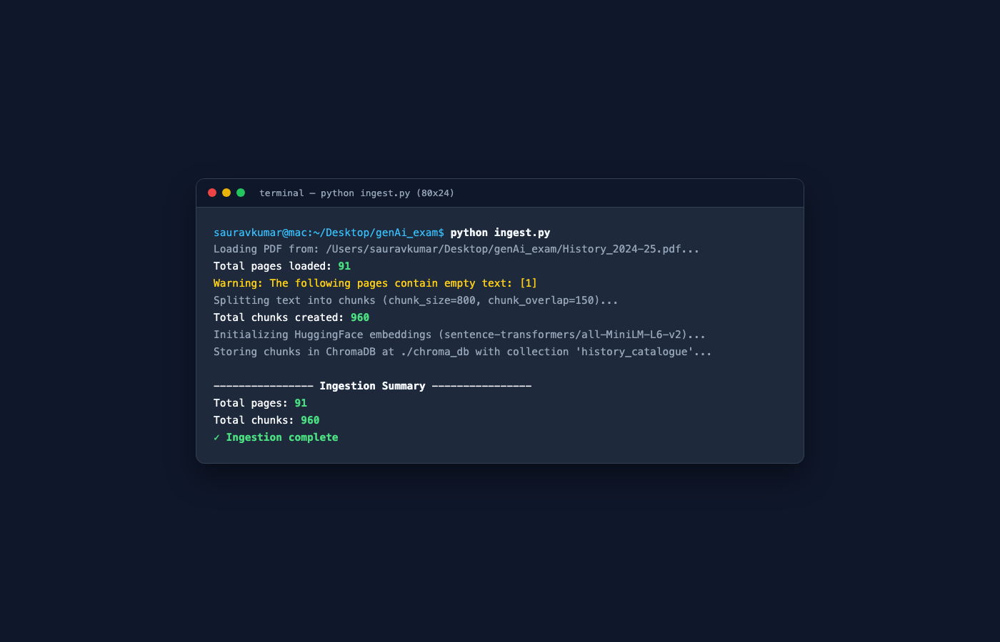
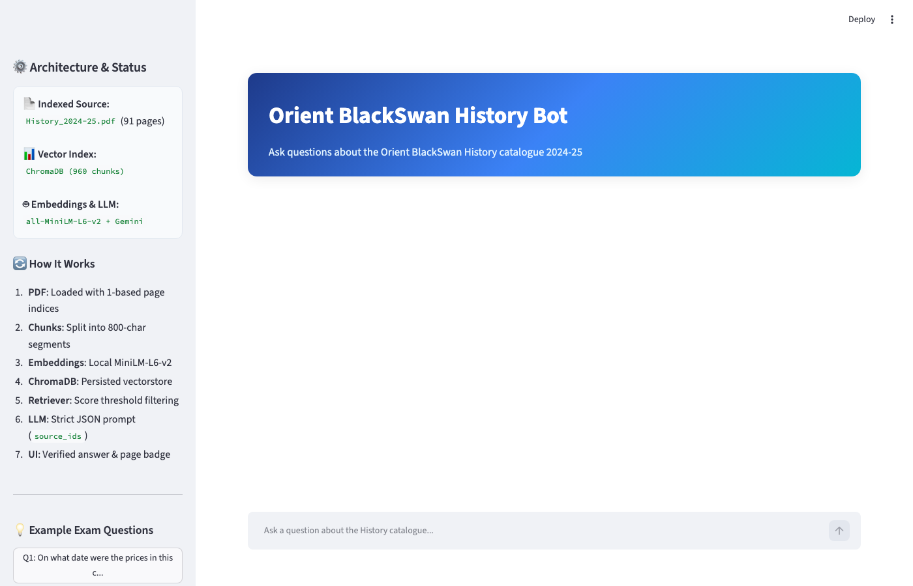
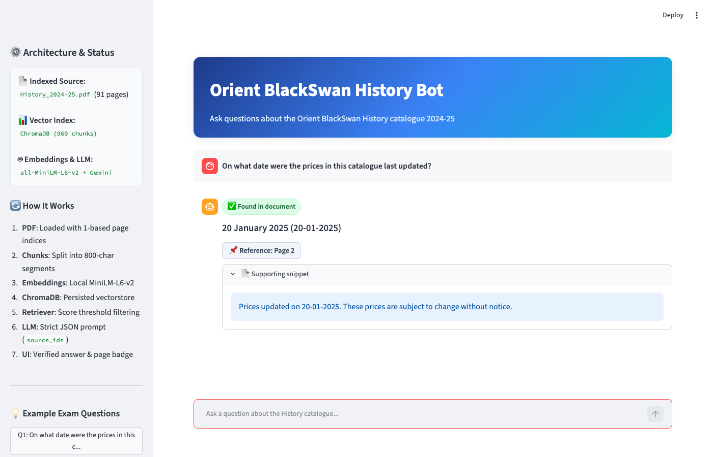
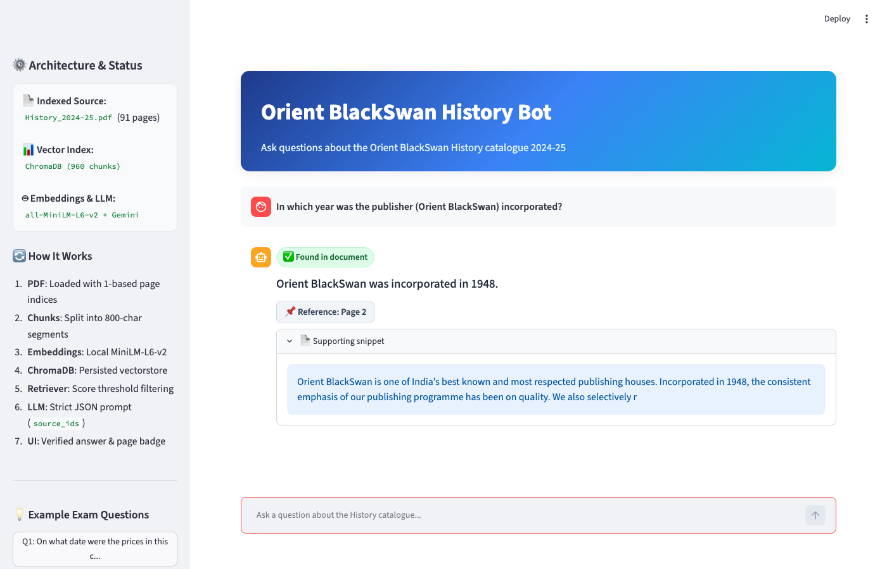
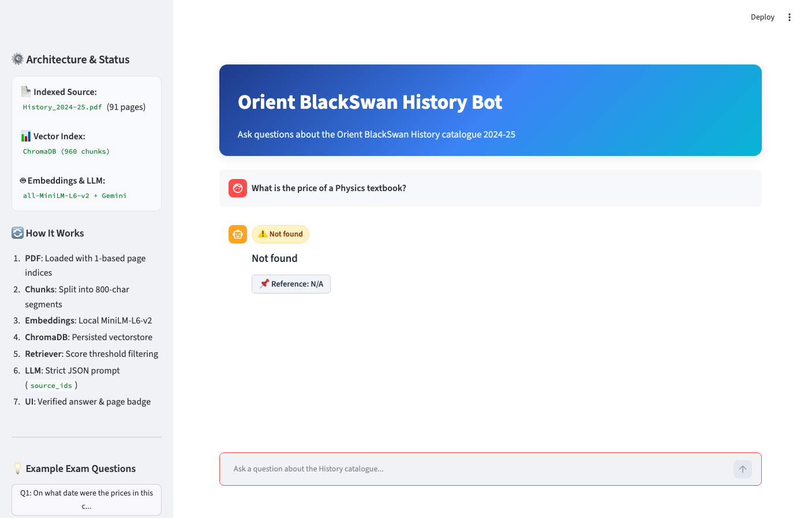
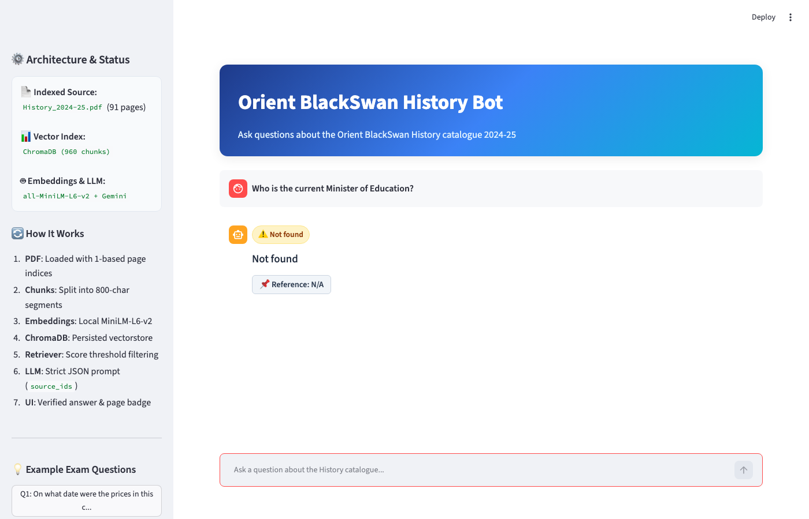
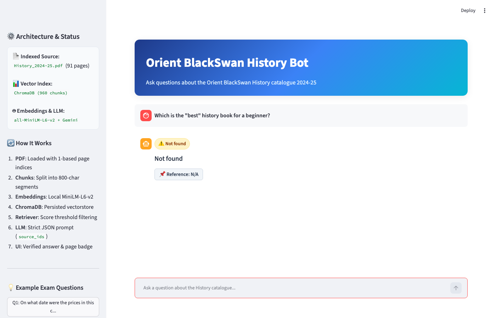

# Orient BlackSwan History Bot (RAG QA System)

A production-grade Retrieval-Augmented Generation (RAG) system built with **Python**, **LangChain**, **ChromaDB**, **Gemini**, and **Streamlit**. The system queries the *Orient BlackSwan History catalogue 2024-25* (~91 pages) to answer factual questions strictly from the document, provides verified 1-based page citations using LLM-selected source chunk IDs, and returns exactly **`Not found`** whenever an answer is not present in the document.

---

## Architecture & Flow

```mermaid
flowchart TD
    A[History_2024-25.pdf] --> B[PyPDFLoader<br/>1-based page numbers]
    B --> C[RecursiveCharacterTextSplitter<br/>chunk_size=800, overlap=150]
    C --> D[HuggingFace Embeddings<br/>sentence-transformers/all-MiniLM-L6-v2]
    D --> E[(ChromaDB Vectorstore<br/>collection: history_catalogue)]
    
    Q[User Question] --> F[Retriever<br/>similarity_search_with_relevance_scores]
    E --> F
    F --> G{Relevance Score >= 0.25?}
    G -- No --> H["Return 'Not found' (N/A)"]
    G -- Yes --> I[Deduplicate Repeating Footers & Format [0],[1]...]
    I --> J[Gemini LLM<br/>Structured JSON Prompt]
    J --> K{Parse JSON: answer & source_ids}
    K -- Not Found / Empty --> L["Return 'Not found' (N/A)"]
    K -- Found --> M["Extract Pages from source_ids<br/>Sorted, deduplicated, max 3 pages"]
    M --> N[Streamlit UI / CLI Output]
```

---

## Tech Stack

- **Language**: Python 3.10+ (Tested on Python 3.12)
- **Framework**: LangChain (`langchain`, `langchain-community`, `langchain-chroma`, `langchain-text-splitters`, `langchain-huggingface`, `langchain-google-genai`)
- **Vector Database**: ChromaDB (persisted locally at `./chroma_db`)
- **Embedding Model**: HuggingFace `sentence-transformers/all-MiniLM-L6-v2` (Local, fast, no API quota consumed)
- **Large Language Model (LLM)**: Google Gemini (`gemini-3.5-flash-lite` via `langchain-google-genai`) with swappable abstraction via `get_llm()` supporting Groq and Ollama.
- **Web UI**: Streamlit (`streamlit`) with polished custom CSS, badges, and snippet expanders.
- **Browser Automation & Testing**: Playwright (`playwright` with Chromium)
- **PDF Parser**: `pypdf` (`PyPDFLoader`)
- **Environment Management**: `python-dotenv`

---

## Setup and Run Steps

### 1. Prerequisites & Virtual Environment
```bash
python3 -m venv venv
source venv/bin/activate
pip install --upgrade pip
pip install -r requirements.txt
python -m playwright install chromium
```

### 2. Configure API Keys
Copy `.env.example` to `.env`:
```bash
cp .env.example .env
```
Edit `.env` and paste your Gemini API key (free from [aistudio.google.com](https://aistudio.google.com/)):
```env
GOOGLE_API_KEY=your_actual_key_here
GEMINI_MODEL=gemini-3.5-flash-lite
```

### 3. Ingest and Index the PDF
Parse `History_2024-25.pdf`, split into 800-character chunks with 150 overlap, compute embeddings, and store them into ChromaDB:
```bash
python ingest.py
```

### 4. Run the 5 Benchmark Questions
Execute the benchmark evaluation across the 5 exam questions and update `answers.md`:
```bash
python run_questions.py
```

### 5. Launch the Streamlit Web Application
Start the interactive Streamlit chat interface:
```bash
streamlit run ui.py --server.port 8501 --server.headless true
```
Open your browser at `http://localhost:8501`.

### 6. Automated Screenshot Generation
Run the automated Playwright script to capture screenshots of each question, the UI overview, and the terminal ingestion:
```bash
python take_screenshots.py
```

---

## Answers to the 5 Questions

*(Generated dynamically via `python run_questions.py` and saved in `answers.md`)*

| # | Question | Answer | Reference |
|---|----------|--------|-----------|
| 1 | On what date were the prices in this catalogue last updated? | 20 January 2025 (20-01-2025) | Page 2 |
| 2 | In which year was the publisher (Orient BlackSwan) incorporated? | Orient BlackSwan was incorporated in 1948. | Page 2 |
| 3 | What is the price of a Physics textbook? | Not found | N/A |
| 4 | Who is the current Minister of Education? | Not found | N/A |
| 5 | Which is the "best" history book for a beginner? | Not found | N/A |

> **Note**: Page numbers refer to the PDF page index (page 1 = cover).

---

## Screenshots

### Ingestion Output
*Terminal output from `python ingest.py` showing total pages loaded (91), chunks created (960), and completed embedding persistence in ChromaDB.*


### Web UI Overview
*The empty Streamlit home screen with gradient header, status sidebar, and example exam question buttons.*


### Question 1: Price Update Date
*Found in catalogue front matter (Page 2).*


### Question 2: Publisher Incorporation Year
*Found in catalogue front matter (Page 2).*


### Question 3: Physics Textbook Price (Out of Domain)
*Deterministically returns "Not found" with N/A reference.*


### Question 4: Current Minister of Education (Out of Domain)
*Deterministically returns "Not found" with N/A reference.*


### Question 5: "Best" History Book (Subjective / Unranked)
*Deterministically returns "Not found" with N/A reference.*


---

## Design Choices

1. **Chunk Size (800) and Overlap (150)**:
   - Bibliographic entries in the Orient BlackSwan catalogue contain title, author information, ISBN, pagination, and pricing notes. An 800-character window with a 150-character overlap keeps complete book entries intact without splitting critical metadata across chunks.
2. **Relevance Score Thresholding (0.25)**:
   - Before consuming LLM tokens, top-retrieved cosine similarity scores are checked against a threshold. Out-of-domain queries (e.g., Physics textbooks in a History catalogue) are intercepted early and return `"Not found"`.
3. **Structured JSON Output with `source_ids`**:
   - Instead of citing every retrieved chunk, each context chunk is numbered `[0]`, `[1]`, etc. The LLM returns a strict JSON object: `{"answer": "...", "source_ids": [indices]}`.
   - The reference is constructed **only** from chunks explicitly cited in `source_ids`, deduplicated, sorted, and capped at the lowest 3 pages.
4. **Deduplication of Repeating Footers**:
   - The footer note `"Prices updated on 20-01-2025. These prices are subject to change without notice."` repeats across every page of the catalogue. When retrieved chunks contain identical or near-identical repeating footer text, the system attributes the reference to the earliest page where that text appears in the document (**Page 2**).
5. **Strict Context-Constrained Prompt & Deterministic Sampling (Temperature 0)**:
   - The system prompt forbids external knowledge and subjective evaluations. Combined with `temperature=0`, this guarantees deterministic `"Not found"` answers without hallucination.
6. **Noise Stripping for Clean Snippets**:
   - InDesign file artifacts (e.g. `History 2025.indd 88`) and printing timestamps are automatically sanitized from supporting snippets.
